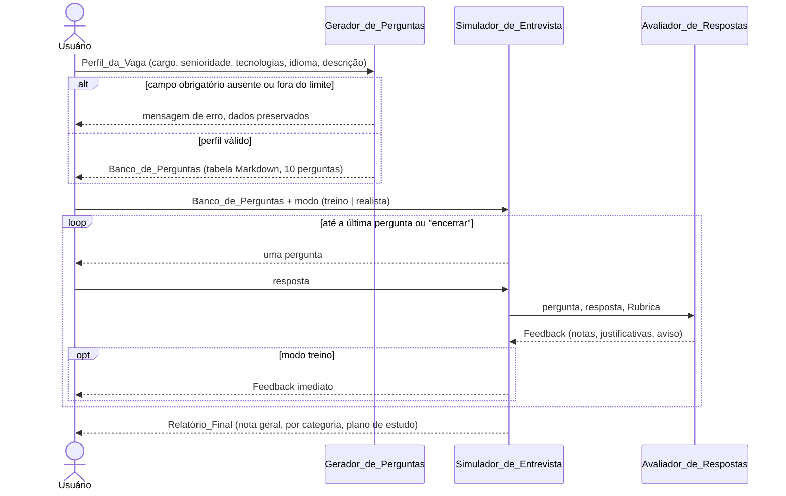
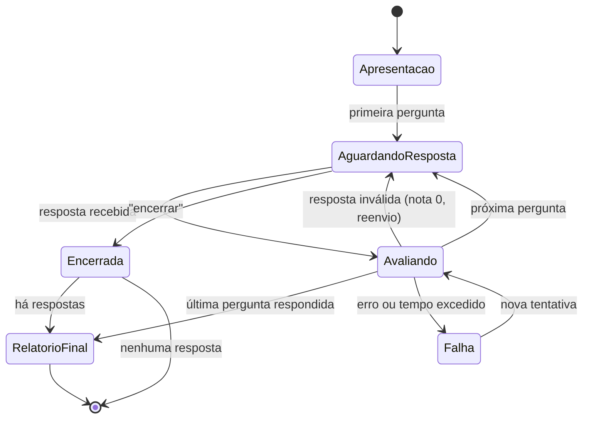

# Design Document

## Overview

O IA Entrevistador é um conjunto de três prompts versionados, reutilizáveis em qualquer Assistente_de_IA baseado em conversa (por exemplo, ChatGPT, Claude, Gemini ou Copilot, citados apenas como ilustração), mais a documentação que os acompanha (README, Registro de Prompts, LICENSE). Não existe código de aplicação: o "sistema" é o comportamento que os prompts induzem no Assistente_de_IA, e os "componentes" são arquivos de texto. O projeto não depende de nenhum produto específico.

Os três prompts cobrem as funções definidas nos requisitos:

| Prompt | Papel no glossário | Requisitos principais |
|---|---|---|
| `gerador-de-perguntas` | Gerador_de_Perguntas | 1, 2, 9.3 |
| `simulador-de-entrevista` | Simulador_de_Entrevista | 3, 5, 6.8 |
| `avaliador-de-respostas` | Avaliador_de_Respostas | 4, 6.6, 9.2 |

### Decisões de design e justificativas

1. **Um arquivo por prompt, com todas as versões no mesmo arquivo** (Req. 6.1, 7.5). Facilita comparar versões e preserva o histórico sem depender de Git.
2. **Prompts de papel único, com contrato de saída fixo.** Cada prompt declara os campos de saída por nome. Isso permite validar a saída de forma objetiva (Req. 6.7).
3. **Cálculos explicitados no prompt, não deixados à intuição do modelo.** A nota ponderada, a média geral e a ordenação do plano de estudo são fórmulas escritas no prompt, com um exemplo resolvido. Modelos de linguagem erram aritmética com frequência, então o prompt manda mostrar os termos do cálculo.
4. **Simulador sem estado externo.** O Assistente_de_IA não persiste dados entre conversas. O histórico da simulação vive na própria conversa, e o prompt instrui o Assistente_de_IA a manter um "estado interno" resumido (índice da pergunta, modo, notas) que é reexibido quando o Usuário pede retomada após falha (Req. 3.10, 5.6).
5. **Validação por checklist e por validador de artefatos.** Como os Assistentes_de_IA são não determinísticos, a qualidade é verificada de duas formas: (a) cenários de teste manuais registrados no Registro de Prompts; (b) um validador leve e determinístico, que confere regras estruturais e aritméticas sobre os arquivos e sobre saídas coladas (ver Testing Strategy).
6. **Idioma.** Toda a documentação e os prompts são em português do Brasil. A entrevista usa o idioma do Perfil_da_Vaga, com português do Brasil como padrão (Req. 1.5).
7. **Portabilidade entre assistentes.** Os prompts são texto puro em Markdown, sem recursos exclusivos de um produto (sem plugins, ferramentas, arquivos anexos, memória persistente ou sintaxe proprietária). Todos seguem a mesma estrutura de cinco seções e o mesmo estilo de saída estruturada (tabela Markdown ou lista com campos fixos), de modo que o usuário cola o prompt em uma conversa nova de qualquer Assistente_de_IA. O comportamento e a qualidade das saídas variam entre assistentes e entre modelos, e isso é tratado como limitação conhecida (README, Req. 8.7) e como objeto de teste (cenário executado em mais de um assistente, Req. 10.7 e 10.8).

### Pesquisa e achados que embasam o design

- Estrutura de prompt em seções (papel, contexto, tarefa, restrições, formato de saída) e uso de exemplos few-shot e saída estruturada são práticas gerais de engenharia de prompt, amplamente aceitas e independentes de fornecedor. O design adota essas práticas nos três prompts.
- O método STAR (Situação, Tarefa, Ação, Resultado) é o formato padrão para avaliar respostas comportamentais e será usado como lista de verificação no Feedback (Req. 4.5).
- Modelos generativos podem produzir fatos incorretos. Por isso o design inclui a marcação "verificar em fonte oficial" (Req. 9.3), o aviso de estimativa na nota (Req. 9.2) e a seção de limitações no README (Req. 8.7).

## Architecture

### Estrutura do repositório

```
HireIA/
├── README.md
├── LICENSE
├── prompts/
│   ├── gerador-de-perguntas.md
│   ├── simulador-de-entrevista.md
│   └── avaliador-de-respostas.md
├── docs/
│   └── registro-de-prompts.md
├── tools/                       (opcional)
│   ├── validar_artefatos.py
│   └── tests/
└── .kiro/specs/ia-entrevistador/
```

Os arquivos de prompt estão em `prompts/`. O Registro_de_Prompts está em `docs/registro-de-prompts.md` e referencia cada arquivo de prompt (Req. 7.5). O README usa links relativos para os três prompts e para o registro (Req. 8.4).

### Fluxo de uso



### Máquina de estados da simulação



## Components and Interfaces

Cada prompt tem a mesma anatomia de arquivo:

```
# <Nome do prompt>
## Metadados        (identificador, objetivo, Técnica_de_Prompt aplicada e trecho)
## Variáveis        (lista {{variável}} com descrição de 1 linha)
## Prompt vN        (texto completo, com as 5 seções)
   ### Papel
   ### Contexto
   ### Tarefa
   ### Restrições
   ### Formato de saída
## Exemplos         (entrada e saída)
## Histórico de versões (vN, data AAAA-MM-DD, motivo, resultado)
```

### Variáveis comuns

`{{cargo}}`, `{{senioridade}}`, `{{tecnologias}}` aparecem em todos os prompts. Variáveis adicionais: `{{idioma}}`, `{{descricao_da_vaga}}` (opcional), `{{modo}}` (treino ou realista), `{{banco_de_perguntas}}`, `{{pergunta}}`, `{{resposta_do_candidato}}`, `{{categoria}}`. Cada prompt lista apenas as que usa, e todas as variáveis presentes no texto aparecem na lista (Req. 6.4). Se alguma variável estiver sem valor, o prompt instrui o Assistente_de_IA a pedir o valor antes de executar e a manter os valores já informados (Req. 6.5).

### Gerador_de_Perguntas

- **Entrada:** Perfil_da_Vaga.
- **Validação de entrada (no prompt):** cargo de 1 a 100 caracteres; Senioridade em {Estagiário, Júnior, Pleno, Sênior, Especialista}; até 20 tecnologias de 1 a 50 caracteres; descrição de 1 a 5.000 caracteres. Em caso de violação, devolve uma única mensagem de erro listando todos os campos inválidos com o limite excedido, ou os valores aceitos de Senioridade, e não altera o perfil (Req. 1.2, 1.4, 1.6, 2.8).
- **Saída:** tabela Markdown com as colunas `número | pergunta | categoria | dificuldade | resposta de referência` (Req. 2.7). São 10 perguntas, com pelo menos 2 de cada categoria, uma dificuldade por pergunta e resposta de referência de até 1.000 caracteres (Req. 2.1 a 2.3).
- **Distribuição por Senioridade (Req. 2.4):** o prompt traz uma tabela de regra e pede que o modelo faça a contagem antes de entregar.

  | Senioridade | Dificuldade predominante (mínimo 5 de 10) |
  |---|---|
  | Estagiário, Júnior | Básico |
  | Pleno | Intermediário |
  | Sênior, Especialista | Avançado |

- **Mais perguntas:** gera 5 novas, sem repetir temas, e devolve o banco completo com as anteriores preservadas (Req. 2.6).
- **Incerteza factual:** a resposta de referência recebe o texto literal "verificar em fonte oficial" (Req. 9.3).
- **Falha:** se não houver 10 perguntas válidas, informa a falha e aceita "tentar novamente" sem novo envio do perfil (Req. 2.9).
- **Técnicas:** role prompting, saída estruturada e restrições explícitas.

### Simulador_de_Entrevista

- **Entrada:** Perfil_da_Vaga, Banco_de_Perguntas, `{{modo}}`.
- **Comportamento:** apresenta o Entrevistador_Simulado (nome fictício e cargo) e faz a primeira pergunta. Faz uma pergunta por mensagem, aguarda a resposta e permite no máximo uma pergunta de aprofundamento consecutiva (Req. 3.1 a 3.3). Linguagem formal, sem gírias, emojis ou ofensas (Req. 3.4).
- **Comandos:** "encerrar" (sem diferenciar maiúsculas) finaliza a simulação. Sem respostas, informa que não há o que avaliar e não gera relatório (Req. 3.5, 3.9).
- **Modos:** treino exibe o Feedback após cada resposta. Realista só o exibe no Relatório_Final (Req. 3.7, 3.8).
- **Fora de escopo:** responde em até 3 frases, repete a última pergunta sem resposta e preserva o histórico (Req. 6.8).
- **Delegação da avaliação:** o prompt embute as regras de avaliação do Avaliador_de_Respostas por referência de papel. Como o Assistente_de_IA opera em uma única conversa, o simulador executa a avaliação internamente usando a Rubrica e o formato do avaliador, e o usuário pode usar o avaliador isoladamente.
- **Relatório_Final** (Req. 5):
  - Nota geral: média aritmética das notas de todas as perguntas respondidas, com uma casa decimal.
  - Nota média por categoria: apenas categorias com pelo menos uma pergunta respondida.
  - Resumo de até 1.000 caracteres.
  - Com 3 ou mais respostas: exatamente 3 pontos fortes e 3 pontos de melhoria, até 200 caracteres cada, vinculados a uma categoria.
  - Com menos de 3 respostas: relatório marcado como parcial no início, com 0 a 2 pontos de cada tipo.
  - Com 0 respostas: mensagem de ausência de dados, sem nota nem plano.
  - Plano de estudo com 1 a 5 tópicos, ordenado por nota média da categoria crescente e, em empate, por nome da categoria em ordem alfabética.
  - Em falha, até 3 novas tentativas, preservando respostas e notas (Req. 5.6).
- **Técnicas:** role prompting, restrições explícitas, saída estruturada.

### Avaliador_de_Respostas

- **Entrada:** pergunta, categoria, resposta do candidato, Rubrica.
- **Rubrica (Req. 4.2):**

  | Critério | Peso |
  |---|---|
  | Correção técnica | 30% |
  | Clareza | 20% |
  | Profundidade | 20% |
  | Estrutura da resposta | 15% |
  | Exemplos práticos | 15% |

  Os pesos são inteiros, maiores que 0, e somam 100%. Os valores acima são o ponto de partida e podem ser ajustados nas versões do prompt, desde que as restrições se mantenham.
- **Notas:** nota inteira de 0 a 10 por critério. Nota final = soma(peso × nota) / 100, arredondada a uma casa decimal (Req. 4.3). O prompt instrui o modelo a exibir a conta.
- **Justificativas:** 1 a 3 frases por critério, citando trecho ou aspecto da resposta (Req. 4.7).
- **Feedback (campos fixos):** `Notas por critério`, `Nota final`, `Pontos fortes`, `Pontos de melhoria`, `Resposta sugerida`, `Verificação STAR` (só para perguntas comportamentais, com Situação, Tarefa, Ação e Resultado como presente ou ausente), `Aviso`. Cada item de texto tem de 1 frase a 1.000 caracteres (Req. 4.4, 4.5).
- **Aviso (Req. 9.2):** frase fixa de até 200 caracteres, na mesma mensagem da nota. Exemplo: "Esta nota é uma estimativa de apoio ao estudo e não substitui a avaliação de um profissional."
- **Resposta inválida (Req. 4.6):** resposta vazia, só espaços, ou fora do assunto resulta em nota final 0, mensagem com o motivo, pedido de reenvio para a mesma pergunta, e a simulação não avança.
- **Falha (Req. 4.9):** informa que a avaliação não foi concluída, preserva a resposta e aceita "reavaliar" sem nova digitação.
- **Consistência (Req. 4.8):** parâmetros como temperatura não são controláveis de forma portável entre Assistentes_de_IA, então o prompt não depende deles e usa critérios observáveis e exemplo few-shot para reduzir a variação. A meta de diferença máxima de 1 ponto é verificada nos cenários de teste.
- **Técnicas:** few-shot (pelo menos um exemplo completo, Req. 6.6), saída estruturada, restrições explícitas.

### Privacidade e viés (transversal)

Todos os prompts incluem na seção Restrições: não usar nem inferir gênero, idade, origem, etnia, religião, orientação sexual, deficiência ou estado civil (Req. 9.4); ignorar dados sensíveis informados e lembrar, em uma frase, de não inseri-los (Req. 9.5). O README tem a seção "Privacidade e Segurança" (Req. 9.1).

### README

Seções, nesta ordem (Req. 8.1): título e descrição, objetivo, tags, funcionalidades, pré-requisitos, estrutura do repositório, como usar, exemplo de sessão, técnicas de engenharia de prompt, resultados e aprendizados, limitações, próximos passos e licença. A seção "Privacidade e Segurança" fica logo após "Limitações". Como a lista do Req. 8.1 é fechada, ela entra como subseção de "Limitações" para não quebrar a ordem exigida. Tags, exatamente: IA, Engenharia de Prompt, IA Generativa, Assistentes de IA (Req. 8.5). O passo a passo é genérico, válido para qualquer Assistente_de_IA (colar o prompt em uma conversa nova, preencher as variáveis, seguir até o Relatório_Final), com de 5 a 15 passos numerados, e pode citar assistentes específicos apenas como exemplo (Req. 8.2). A seção "Limitações" inclui respostas incorretas, necessidade de revisão humana e variação de comportamento e qualidade entre assistentes e modelos (Req. 8.7). O exemplo de sessão traz pergunta, resposta e Feedback integrais (Req. 8.3). A seção de licença nomeia a licença e referencia `LICENSE` (Req. 8.9).

### Registro_de_Prompts

Arquivo `docs/registro-de-prompts.md` com:

1. **Índice de prompts**, com link para cada arquivo em `prompts/`.
2. **Ficha por prompt:** objetivo (1 a 300 caracteres), texto completo, técnica (exatamente uma por prompt, conforme glossário), exemplo de entrada, exemplo de saída e versão atual `vN` (Req. 7.1). Como cada arquivo de prompt já contém as versões, a ficha aponta para ele e replica os campos obrigatórios.
3. **Comparação de versões do Avaliador:** pelo menos 2 versões testadas com o mesmo conjunto de pelo menos 3 entradas, e texto indicando a versão adotada e o motivo (Req. 7.3).
4. **Lições aprendidas:** pelo menos 3 entradas com problema, correção e versão (Req. 7.4).
5. **Cenários de teste** (3 a 20), cada um com o assistente e o modelo usados na execução, e **checklist de qualidade** (Req. 10.1, 10.2, 10.5).
6. **Portabilidade entre assistentes:** pelo menos 1 cenário executado com a mesma entrada em 2 ou mais Assistentes_de_IA, com o resultado dos critérios por execução e, quando houver divergência, o assistente e o modelo em que cada critério foi reprovado (Req. 10.7, 10.8).

## Data Models

Os dados são texto estruturado. Os modelos abaixo definem o contrato de cada artefato.

### Perfil_da_Vaga

| Campo | Tipo | Regra |
|---|---|---|
| cargo | texto | obrigatório, 1 a 100 caracteres |
| senioridade | enum | Estagiário, Júnior, Pleno, Sênior, Especialista |
| tecnologias | lista de texto | 0 a 20 itens, 1 a 50 caracteres cada |
| descricao_da_vaga | texto | opcional, 1 a 5.000 caracteres |
| idioma | texto | opcional, padrão "português do Brasil" |

### Pergunta (linha do Banco_de_Perguntas)

| Campo | Regra |
|---|---|
| numero | inteiro sequencial a partir de 1 |
| pergunta | texto, tema único no banco |
| categoria | Técnica, Comportamental ou Situacional |
| dificuldade | Básico, Intermediário ou Avançado |
| resposta_de_referencia | texto não vazio, até 1.000 caracteres |

Invariantes do banco: 10 perguntas na geração inicial (15 após "mais perguntas", 20 após duas); pelo menos 2 por categoria; pelo menos 5 da dificuldade predominante da Senioridade.

### Feedback

| Campo | Regra |
|---|---|
| notas_por_criterio | 5 inteiros de 0 a 10, um por critério da Rubrica |
| justificativas | 5 textos de 1 a 3 frases |
| nota_final | decimal de 0 a 10, uma casa, igual a round1(soma(peso × nota) / 100) |
| pontos_fortes, pontos_de_melhoria, resposta_sugerida | texto de 1 frase a 1.000 caracteres |
| verificacao_star | 4 booleanos (presente/ausente), só para Comportamental |
| aviso | texto de até 200 caracteres |

### Relatório_Final

| Campo | Regra |
|---|---|
| parcial | verdadeiro se houver menos de 3 respostas |
| nota_geral | média aritmética das notas finais, uma casa decimal |
| nota_por_categoria | média por categoria com pelo menos 1 resposta |
| resumo | até 1.000 caracteres |
| pontos_fortes, pontos_de_melhoria | 3 de cada (completo) ou 0 a 2 de cada (parcial), até 200 caracteres, com categoria |
| plano_de_estudo | 1 a 5 tópicos, ordenados por nota da categoria crescente, depois nome da categoria |

### Registro de versão

| Campo | Regra |
|---|---|
| versao | `vN`, N inteiro maior ou igual a 1, incrementado em 1 |
| data | AAAA-MM-DD |
| motivo | 1 a 500 caracteres |
| resultado_observado | 1 a 500 caracteres |
| texto | texto integral da versão, preservado |

### Cenário de teste

| Campo | Regra |
|---|---|
| id | único |
| perfil | Perfil_da_Vaga distinto dos demais cenários |
| execucoes | lista de 1 ou mais execuções. Cada execução tem `assistente` (nome do Assistente_de_IA), `modelo`, `entrada`, `saida_obtida`, `data` (AAAA-MM-DD) e `verificacoes` (aprovado/reprovado por critério de aceitação aplicável) |
| multiplos_assistentes | verdadeiro se a mesma entrada foi executada em 2 ou mais assistentes distintos |
| divergencias | para cada critério com resultado diferente entre execuções, o par assistente e modelo em que o critério foi reprovado |
| checklist | 5 itens (relevância, aderência à Senioridade, formato de saída, coerência das notas, clareza), cada um verdadeiro ou falso |
| resultado | reprovado se qualquer item do checklist ou verificação for reprovado, indicando os itens |

O conjunto de cenários tem de 3 a 20 itens, cobre pelo menos 2 Senioridades, e inclui pelo menos 1 resposta vazia ou em branco e 1 resposta fora de contexto (Req. 10.1, 10.3).

## Correctness Properties

*A property is a characteristic or behavior that should hold true across all valid executions of a system-essentially, a formal statement about what the system should do. Properties serve as the bridge between human-readable specifications and machine-verifiable correctness guarantees.*

**Escopo.** Os Assistentes_de_IA não são determinísticos e cada chamada é lenta, então as propriedades não são verificadas repetindo prompts. Elas descrevem regras determinísticas que qualquer saída ou artefato válido deve cumprir. São verificadas por um validador (`tools/validar_artefatos.py`) que recebe a saída em texto (colada de uma sessão real ou gerada sinteticamente) e confere a regra. As regras que dependem de julgamento semântico (relevância, ausência de tema repetido, tom, viés) ficam no checklist manual.

### Property 1: Validação do Perfil_da_Vaga

*For any* Perfil_da_Vaga candidato, o validador aceita o perfil se e somente se cargo tem 1 a 100 caracteres, Senioridade pertence aos cinco valores, tecnologias têm 0 a 20 itens de 1 a 50 caracteres e a descrição, quando presente, tem 1 a 5.000 caracteres. Caso contrário, a mensagem de erro cita todos os campos inválidos de uma vez.

**Validates: Requirements 1.1, 1.2, 1.6**

### Property 2: Campos obrigatórios ausentes são todos listados

*For any* subconjunto de campos obrigatórios (cargo, Senioridade) ausentes do perfil, a mensagem de erro lista exatamente os campos ausentes, e os campos informados permanecem inalterados.

**Validates: Requirements 1.4, 2.8**

### Property 3: Estrutura do Banco_de_Perguntas

*For any* Banco_de_Perguntas em tabela Markdown produzido para uma Senioridade, o banco tem as colunas `número, pergunta, categoria, dificuldade, resposta de referência`, uma linha por pergunta, categoria e dificuldade em seus conjuntos válidos, resposta de referência não vazia com até 1.000 caracteres, pelo menos 2 perguntas de cada categoria, e pelo menos 5 perguntas na dificuldade predominante da Senioridade.

**Validates: Requirements 2.1, 2.2, 2.3, 2.4, 2.7**

### Property 4: Expansão do banco preserva as perguntas

*For any* Banco_de_Perguntas válido, após "mais perguntas" o novo banco contém 5 linhas a mais, e as linhas anteriores aparecem inalteradas e na mesma ordem.

**Validates: Requirements 2.6**

### Property 5: Pesos da Rubrica

*For any* Rubrica, ela é válida se e somente se contém os cinco critérios exigidos, com pesos inteiros maiores que 0 cuja soma é 100.

**Validates: Requirements 4.2**

### Property 6: Nota final ponderada

*For any* conjunto de cinco notas inteiras de 0 a 10 e qualquer Rubrica válida, a nota final informada no Feedback é igual a soma(peso × nota) / 100 arredondada a uma casa decimal, e está entre 0 e 10.

**Validates: Requirements 4.3**

### Property 7: Estrutura do Feedback

*For any* Feedback com nota, ele contém uma nota inteira de 0 a 10 por critério, justificativa de 1 a 3 frases por critério, ao menos um ponto forte, um ponto de melhoria e uma resposta sugerida (1 frase a 1.000 caracteres cada), e o aviso de até 200 caracteres na mesma mensagem. Se a pergunta é Comportamental, contém também o estado (presente ou ausente) dos quatro elementos STAR.

**Validates: Requirements 4.4, 4.5, 4.7, 9.2**

### Property 8: Resposta em branco recebe nota 0

*For any* resposta composta apenas de espaços em branco (incluindo vazia), o resultado esperado do Avaliador é nota final 0, mensagem com o motivo e pedido de reenvio sem avançar para a próxima pergunta.

**Validates: Requirements 4.6**

### Property 9: Notas do Relatório_Final

*For any* lista de respostas avaliadas, com categorias e notas finais, a nota geral do relatório é a média aritmética das notas com uma casa decimal, e a nota por categoria é a média das notas da categoria, presente somente para categorias com pelo menos uma resposta.

**Validates: Requirements 5.1**

### Property 10: Conteúdo do relatório conforme o número de respostas

*For any* simulação com n respostas, o relatório tem exatamente 3 pontos fortes e 3 de melhoria quando n ≥ 3, é marcado como parcial com 0 a 2 de cada quando 0 < n < 3, e para n = 0 não contém nota geral, nota por categoria nem plano de estudo.

**Validates: Requirements 5.2, 5.4, 5.5**

### Property 11: Ordenação do plano de estudo

*For any* conjunto de notas médias por categoria, o plano de estudo tem de 1 a 5 tópicos ordenados por nota média crescente e, em empate, por nome da categoria em ordem alfabética.

**Validates: Requirements 5.3**

### Property 12: Regras de formato das mensagens do entrevistador

*For any* transcrição de simulação, cada mensagem do Entrevistador_Simulado contém no máximo uma pergunta nova e nenhum emoji, e nunca há mais de uma pergunta de aprofundamento consecutiva sobre a mesma resposta.

**Validates: Requirements 3.2, 3.3, 3.4**

### Property 13: Conformidade do arquivo de prompt

*For any* arquivo de prompt, ele tem as cinco seções (papel, contexto, tarefa, restrições, formato de saída) com texto não vazio, define os campos de saída por nome, e o conjunto de variáveis `{{nome}}` usadas no texto é igual ao conjunto listado na seção Variáveis (cada uma com descrição de 1 linha) e inclui `{{cargo}}`, `{{senioridade}}` e `{{tecnologias}}`. O prompt do Avaliador contém ao menos um exemplo completo com pergunta, resposta e Feedback.

**Validates: Requirements 6.2, 6.4, 6.6, 6.7**

### Property 14: Histórico de versões

*For any* arquivo de prompt com k versões, os identificadores são `v1, v2, ..., vk` sem lacunas, cada versão tem data AAAA-MM-DD, motivo (1 a 500 caracteres), resultado (1 a 500 caracteres) e texto integral não vazio, e o texto de cada versão anterior permanece idêntico entre revisões do arquivo.

**Validates: Requirements 7.1, 7.2**

### Property 15: Links relativos do README

*For any* README, todo link relativo aponta para um arquivo existente no repositório, e há um link para cada arquivo de `prompts/` e para o Registro_de_Prompts.

**Validates: Requirements 8.4, 8.8**

### Property 16: Resultado de cenário de teste

*For any* cenário de teste com itens de checklist marcados como verdadeiro ou falso e verificações aprovadas ou reprovadas, o cenário é registrado como reprovado se e somente se há ao menos um item ou verificação reprovado, e os itens reprovados estão listados. Para cenários de resposta vazia ou fora de contexto, o cenário é reprovado quando o comportamento observado diverge do esperado.

**Validates: Requirements 10.4, 10.6**

### Property 17: Divergências entre assistentes são registradas com assistente e modelo

*For any* cenário de teste executado com a mesma entrada em 2 ou mais execuções, e quaisquer resultados de verificação (aprovado ou reprovado) por critério em cada execução, o registro de divergências contém exatamente os critérios cujo resultado difere entre as execuções, e cada critério listado indica o assistente e o modelo das execuções em que foi reprovado. Se todos os resultados coincidem, o registro de divergências é vazio. Toda execução registrada tem assistente e modelo não vazios.

**Validates: Requirements 10.2, 10.7, 10.8**

## Error Handling

| Situação | Tratamento | Requisito |
|---|---|---|
| Senioridade inválida | Rejeita, mantém o perfil, lista os cinco valores aceitos | 1.2 |
| Campo acima do limite | Uma mensagem única com todos os campos e limites excedidos | 1.6 |
| Cargo ou Senioridade ausente | Não gera perguntas, lista os campos ausentes, preserva os demais | 1.4, 2.8 |
| Banco com menos de 10 perguntas válidas ou tempo acima de 60 s | Mensagem de falha, "tentar novamente" sem reenviar o perfil | 2.9 |
| Próxima pergunta ou relatório não gerados em 30 s | Mensagem de falha, respostas preservadas, nova tentativa | 3.10 |
| Resposta vazia, só espaços ou fora do assunto | Nota 0 com motivo, reenvio da mesma pergunta, sem avançar | 4.6 |
| Avaliação indisponível ou acima de 30 s | Mensagem de falha, resposta preservada, reavaliação sem redigitar | 4.9 |
| Falha na geração do relatório | Mensagem de falha, até 3 novas tentativas | 5.6 |
| Variável `{{nome}}` sem valor | Pede o valor antes de executar, mantém os demais | 6.5 |
| Assunto fora do escopo | Resposta de até 3 frases e retomada da última pergunta | 6.8 |
| Fato técnico incerto | Marca "verificar em fonte oficial" e mantém a pergunta | 9.3 |
| Dado pessoal sensível informado | Ignora o dado e lembra em uma frase de não inseri-lo | 9.5 |
| Artefato sem campo obrigatório | Registro marcado como incompleto, campo ausente apontado na revisão | 7.6 |

Os limites de tempo dependem do Assistente_de_IA e do modelo utilizados e não são garantidos pelo prompt. O prompt instrui o comportamento de falha; a medição do tempo é feita nos cenários de teste (verificação manual).

## Testing Strategy

### Por que a estratégia combina validador e cenários manuais

O projeto entrega prompts e documentos, sem lógica de aplicação. Property-based testing (PBT) não se aplica às chamadas aos Assistentes_de_IA: elas são não determinísticas, lentas e externas, e 100 iterações não revelariam mais defeitos que poucos cenários bem escolhidos. PBT se aplica à parte determinística: as regras aritméticas, de ordenação e de estrutura descritas nas Correctness Properties, que o validador implementa como funções puras. Todas as propriedades acima são verificadas contra esse validador, não contra um Assistente_de_IA.

### 1. Testes de propriedade do validador

- **Linguagem e biblioteca:** Python com [Hypothesis](https://hypothesis.readthedocs.io/) e pytest. Não implementar geração aleatória própria.
- **Local:** `tools/tests/`.
- **Configuração:** mínimo de 100 iterações por teste (`@settings(max_examples=100)`).
- **Regra:** cada propriedade é implementada por um único teste de propriedade, com comentário no formato `Feature: ia-entrevistador, Property N: <texto da propriedade>`.
- **Geradores:**
  - Propriedades 1 e 2: perfis com textos de comprimento em torno dos limites (0, 1, 100, 101, 5.000, 5.001), listas de 0 a 21 itens, Senioridades válidas e inválidas.
  - Propriedades 3 e 4: tabelas Markdown geradas com categorias, dificuldades e tamanhos de resposta variados, incluindo casos que violam cada regra.
  - Propriedades 5 e 6: pesos inteiros que somam ou não 100, notas de 0 a 10.
  - Propriedades 7, 8, 12: Feedbacks e transcrições sintéticos, respostas só com espaços, tabs e quebras de linha, mensagens com emojis.
  - Propriedades 9 a 11: listas de notas e categorias, incluindo empates, categorias ausentes e n = 0, 1, 2, 3 ou mais.
  - Propriedades 13 e 14: arquivos de prompt sintéticos com seções faltando, variáveis usadas e não declaradas, versões com lacunas.
  - Propriedades 15 e 16: árvores de arquivo temporárias com links válidos e quebrados, cenários com combinações de itens aprovados e reprovados.
  - Propriedade 17: listas de 2 ou mais execuções com nomes de assistente e modelo variados (incluindo vazios), resultados por critério aprovados ou reprovados, e casos em que todos coincidem.
- **Execução:** `pytest tools/tests --hypothesis-seed=0` para execução única, sem modo watch.

### 2. Validação dos artefatos reais

O mesmo validador roda sobre os arquivos do repositório: `python tools/validar_artefatos.py`. Ele confere os prompts em `prompts/` (propriedades 13 e 14), o README (propriedade 15 e a ordem das seções do Req. 8.1), o Registro_de_Prompts (contagens do Req. 7.3, 7.4, 10.1 e 10.3) e a presença do arquivo `LICENSE`. A saída lista cada verificação como aprovada ou reprovada e, em reprovação, o campo ausente (Req. 7.6). Estas verificações são smoke tests de execução única.

### 3. Cenários de teste dos prompts (manuais)

Executados em Assistentes_de_IA e registrados no Registro_de_Prompts (Req. 10):

- 3 a 20 cenários com perfis distintos, pelo menos 2 Senioridades.
- Pelo menos 1 cenário de resposta vazia ou só espaços e 1 de resposta fora de contexto.
- Cenários de fluxo: encerrar antes da primeira resposta, encerrar com 1 e com 3 respostas, modo treino e modo realista, assunto fora do escopo, variável ausente, dado sensível informado.
- Cada execução registra o nome do Assistente_de_IA e o modelo (Req. 10.2).
- Portabilidade: pelo menos 1 cenário executado com a mesma entrada em 2 ou mais Assistentes_de_IA, com os critérios verificados em cada execução. Divergências são registradas com o assistente e o modelo em que cada critério foi reprovado (Req. 10.7, 10.8).
- Consistência do Avaliador: avaliar a mesma resposta duas vezes, no mesmo assistente e modelo, e conferir diferença de no máximo 1 ponto (Req. 4.8).
- Saídas reais dos cenários podem ser coladas no validador para conferir as propriedades 3, 6, 7, 9, 10 e 11.
- Medição dos tempos de resposta (Req. 2.9, 3.1, 3.3, 3.10, 4.1, 5.1) feita manualmente, com a ressalva de que depende do serviço.

### 4. Checklist de qualidade e revisão humana

Itens que dependem de julgamento: relevância das perguntas, aderência à Senioridade, formato de saída, coerência das notas e clareza do Feedback (Req. 10.5), mais ausência de tema repetido (Req. 2.5), tom formal (Req. 3.4), ausência de referências a características pessoais (Req. 9.4), conteúdo editorial do README (Req. 8.3, 8.6, 8.7) e a seção "Privacidade e Segurança" (Req. 9.1). Cada item tem condição objetiva de aprovação (verdadeiro ou falso) e resultado por cenário.

### Rastreabilidade

| Tipo de verificação | Requisitos |
|---|---|
| Propriedades (validador) | 1.1, 1.2, 1.4, 1.6, 2.1 a 2.4, 2.6 a 2.8, 3.2 a 3.4, 4.2 a 4.7, 5.1 a 5.5, 6.2, 6.4, 6.6, 6.7, 7.1, 7.2, 8.4, 8.8, 9.2, 10.4, 10.6 (a regra de registro de 10.2, 10.7 e 10.8 também é verificada pela propriedade 17) |
| Smoke (validador sobre o repositório) | 6.1, 7.3 a 7.6, 8.1, 8.2, 8.5, 8.9, 9.1, 10.1, 10.3, 10.5 |
| Cenários manuais (Assistentes_de_IA) | 1.3, 1.5, 2.9, 3.1, 3.5 a 3.10, 4.1, 4.8, 4.9, 5.6, 6.3, 6.5, 6.8, 9.3, 9.5, 10.2, 10.7, 10.8 |
| Revisão humana | 2.5, 8.3, 8.6, 8.7, 9.4 |

Se for preferível não ter código no repositório, a pasta `tools/` pode ser descartada: as propriedades passam a ser verificadas apenas pelo checklist manual e pelos cenários de teste, com perda de cobertura automática nas regras aritméticas e estruturais.
