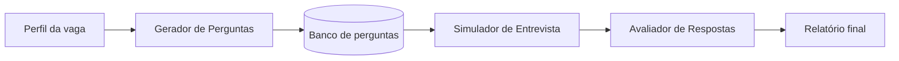

<div align="center">

# IA Entrevistador

**Treine entrevistas técnicas com IA generativa: perguntas sob medida, simulação em diálogo e feedback estruturado.**

[](LICENSE)
[](https://www.python.org/downloads/)
[](https://github.com/Gtvnv/Hire-IA/actions/workflows/ci.yml)
[](prompts/)

[Objetivo](#objetivo-) · [Funcionalidades](#funcionalidades-) · [Estrutura](#estrutura-do-repositório-) · [Como usar](#como-usar-) · [Exemplo](#exemplo-de-sessão-) · [Técnicas](#técnicas-de-engenharia-de-prompt-) · [Resultados](#resultados-e-aprendizados-) · [Reproduzir](#reproduzir-as-evidências-) · [Limitações](#limitações-) · [Próximos passos](#próximos-passos-) · [Licença](#licença-)

</div>

O IA Entrevistador é um projeto de engenharia de prompt que usa IA generativa para simular entrevistas técnicas de emprego. Ele entrega três prompts versionados, em texto puro, que funcionam em qualquer assistente de IA baseado em conversa. Os prompts geram perguntas por cargo e senioridade, conduzem a entrevista em formato de diálogo e avaliam as respostas com uma Rubrica fixa, terminando em um relatório final com plano de estudo. A versão atual do Avaliador de Respostas é a v2.

## Objetivo 🎯

Ajudar quem se prepara para um processo seletivo a treinar com perguntas próximas das reais, receber feedback estruturado e saber o que estudar. O projeto também documenta a evolução dos prompts (versões, testes e lições aprendidas), sem depender de um produto específico.

## Tags 🏷️

- IA
- Engenharia de Prompt
- IA Generativa
- Assistentes de IA

## Funcionalidades ✨



- **Perfil da vaga:** cargo, senioridade (Estagiário, Júnior, Pleno, Sênior ou Especialista), tecnologias, descrição da vaga opcional e idioma (português do Brasil por padrão).
- **Geração de perguntas:** banco com 10 perguntas em tabela Markdown, com categoria (Técnica, Comportamental ou Situacional), dificuldade ajustada à senioridade e resposta de referência. É possível pedir 5 perguntas novas, sem repetir temas.
- **Simulação de entrevista:** uma pergunta por mensagem, em linguagem formal, nos modos treino (Feedback após cada resposta) e realista (Feedback só no relatório). O comando "encerrar" finaliza a simulação.
- **Avaliação de respostas:** cinco critérios ponderados (Correção técnica, Clareza, Profundidade, Estrutura da resposta e Exemplos práticos), nota final com a conta exibida, pontos fortes, pontos de melhoria, resposta sugerida e verificação STAR para perguntas comportamentais.
- **Relatório final:** nota geral, nota por categoria, resumo, pontos fortes e de melhoria e plano de estudo de 1 a 5 tópicos.
- **Validador opcional:** scripts em Python que conferem a estrutura dos prompts, do Registro e deste README.

## Pré-requisitos 📋

- Acesso a um assistente de IA generativa baseado em conversa (por exemplo, ChatGPT, Claude, Gemini ou Copilot, citados apenas como exemplo).
- Um editor de texto ou o navegador para abrir os arquivos de prompt e copiar o conteúdo.
- Opcional, para o validador: Python 3 e as dependências de `tools/requirements.txt` (pytest e hypothesis).
- Para rodar os testes: `pip install -r tools/requirements.txt` e depois `pytest tools/tests`. O CI (GitHub Actions, `.github/workflows/ci.yml`) executa os testes a cada push e pull request com Python 3.12. O passo do validador roda com `continue-on-error`, então não bloqueia o CI.

## Estrutura do repositório 🗂️

```text
.
├── README.md
├── LICENSE
├── prompts/
│   ├── gerador-de-perguntas.md
│   ├── simulador-de-entrevista.md
│   └── avaliador-de-respostas.md
├── docker-compose.yml
├── docs/
│   ├── registro-de-prompts.md
│   └── evidencias/
│       ├── RESUMO.md
│       └── EV01.md ... EV12.md
└── tools/
    ├── validar_artefatos.py
    ├── executar_cenarios.py
    ├── requirements.txt
    └── tests/
```

| Item | Descrição |
|---|---|
| [prompts/gerador-de-perguntas.md](prompts/gerador-de-perguntas.md) | Gerador_de_Perguntas |
| [prompts/simulador-de-entrevista.md](prompts/simulador-de-entrevista.md) | Simulador_de_Entrevista |
| [prompts/avaliador-de-respostas.md](prompts/avaliador-de-respostas.md) | Avaliador_de_Respostas |
| [docs/registro-de-prompts.md](docs/registro-de-prompts.md) | Registro de Prompts, com fichas, versões, cenários de teste e lições aprendidas |
| [docs/evidencias/](docs/evidencias/RESUMO.md) | Evidências: saída bruta de 12 execuções reais (EV01 a EV12) e o resumo com as verificações automáticas |
| [docker-compose.yml](docker-compose.yml) | Sobe o Ollama e um contêiner que roda testes, validador e cenários |
| [tools/executar_cenarios.py](tools/executar_cenarios.py) | Executa os cenários contra o Ollama e grava `docs/evidencias/` |
| `tools/` | Validador determinístico, verificadores de nota e banco, e testes de propriedade (opcional) |

## Como usar 🚀

1. Escolha o assistente de IA que você vai usar e abra uma conversa nova.
2. Abra [prompts/gerador-de-perguntas.md](prompts/gerador-de-perguntas.md) e copie o texto da seção "Prompt v1".
3. Cole o texto na conversa e informe os valores das variáveis `{{cargo}}`, `{{senioridade}}` e `{{tecnologias}}` (e, se quiser, a descrição da vaga e o idioma). Se faltar algum valor, o prompt pede o campo ausente.
4. Confira o banco de 10 perguntas gerado e revise as respostas de referência, principalmente as marcadas com "verificar em fonte oficial".
5. Abra [prompts/simulador-de-entrevista.md](prompts/simulador-de-entrevista.md), copie o texto da seção "Prompt v1" e cole em uma conversa nova.
6. Informe o perfil da vaga, o modo (treino ou realista) e cole o banco de perguntas gerado no passo 3.
7. Responda a uma pergunta por vez, como em uma entrevista real. Se a resposta for vazia ou fora do assunto, o prompt pede o reenvio para a mesma pergunta.
8. No modo treino, leia o Feedback exibido após cada resposta. No modo realista, os Feedbacks aparecem só no relatório.
9. Para avaliar uma resposta isoladamente, use [prompts/avaliador-de-respostas.md](prompts/avaliador-de-respostas.md) (versão atual: v2, seção "Prompt v2") em uma conversa nova, informando a pergunta, a categoria e a resposta.
10. Digite "encerrar" quando quiser parar, ou responda à última pergunta, para receber o Relatório Final.
11. Se uma geração falhar, peça para tentar novamente. Você não precisa reenviar os dados já informados.
12. Use o plano de estudo do relatório para escolher os próximos temas e repita a simulação.

## Exemplo de sessão 💬

> [!NOTE]
> O exemplo abaixo é ilustrativo. Ele reutiliza o exemplo few-shot de [prompts/avaliador-de-respostas.md](prompts/avaliador-de-respostas.md) e não é o resultado de uma execução real em um assistente de IA.

**Perfil da vaga:** Desenvolvedor Back-end, Pleno, tecnologias C# e SQL Server. Categoria da pergunta: Comportamental.

**Pergunta**

Conte sobre uma vez em que você precisou resolver um problema de desempenho em produção.

**Resposta do candidato**

"No meu último projeto, a API de pedidos começou a demorar mais de 8 segundos nos horários de pico. Fiquei responsável por descobrir a causa. Analisei os logs, encontrei uma consulta sem índice e criei o índice na tabela de pedidos. Depois disso o tempo caiu para menos de 1 segundo."

<details>
<summary><strong>Ver o Feedback ilustrativo</strong></summary>

**Feedback**

- **Pergunta avaliada:** Conte sobre uma vez em que você precisou resolver um problema de desempenho em produção.

- **Notas por critério:**

| Critério | Peso | Nota (0 a 10) | Justificativa |
|---|---|---|---|
| Correção técnica | 30% | 8 | A causa apontada, uma consulta sem índice, e a solução com índice são coerentes com o problema descrito. Faltou mencionar como a consulta lenta foi identificada. |
| Clareza | 20% | 7 | A sequência "demorava 8 segundos, analisei os logs, criei o índice" é fácil de acompanhar. Algumas frases são muito curtas e omitem detalhes. |
| Profundidade | 20% | 6 | A resposta cita a causa, mas não discute alternativas, riscos de criar o índice em produção nem como evitar a recorrência. |
| Estrutura da resposta | 15% | 5 | Há problema, ação e resultado, mas o contexto inicial é breve e não há conclusão sobre o que foi aprendido. |
| Exemplos práticos | 15% | 7 | Os números "mais de 8 segundos" e "menos de 1 segundo" tornam o caso concreto e verificável. |

- **Cálculo:** (30 × 8 + 20 × 7 + 20 × 6 + 15 × 5 + 15 × 7) / 100 = (240 + 140 + 120 + 75 + 105) / 100 = 680 / 100 = 6,8.
- **Nota final:** 6,8
- **Pontos fortes:**
  - Apresenta resultado mensurável, com tempo de resposta antes e depois da correção.
  - Mostra iniciativa ao assumir a investigação do problema.
- **Pontos de melhoria:**
  - Explicar como a consulta sem índice foi identificada, por exemplo com plano de execução ou métricas.
  - Descrever o impacto no negócio e o que foi feito para evitar que o problema volte.
- **Resposta sugerida:** "Na API de pedidos, o tempo de resposta passou de 8 segundos nos horários de pico, o que afetava as vendas. Eu fiquei responsável pela investigação. Analisei logs e o plano de execução e identifiquei uma consulta sem índice na tabela de pedidos. Criei o índice em horário de baixo uso, validei em homologação e acompanhei as métricas. O tempo caiu para menos de 1 segundo. Depois, configurei um alerta de lentidão e passamos a revisar planos de execução nas revisões de código."
- **Verificação STAR:**
  - Situação: presente
  - Tarefa: presente
  - Ação: presente
  - Resultado: presente
- **Aviso:** Esta nota é uma estimativa de apoio ao estudo e não substitui a avaliação de um profissional.

</details>

## Técnicas de engenharia de prompt 🧠

| Prompt | Técnica principal | Técnicas complementares | Versão atual |
|---|---|---|---|
| [Gerador de Perguntas](prompts/gerador-de-perguntas.md) | Saída estruturada (tabela com colunas fixas e verificação de contagem) | Definição de papel, restrições explícitas | v1 |
| [Simulador de Entrevista](prompts/simulador-de-entrevista.md) | Restrições explícitas (regras de conduta e limites numéricos) | Definição de papel, saída estruturada | v1 |
| [Avaliador de Respostas](prompts/avaliador-de-respostas.md) | Few-shot (exemplo completo de avaliação) | Saída estruturada, restrições explícitas | **v2** |

Os três prompts usam variáveis nomeadas no formato `{{nome}}`, seções fixas (papel, contexto, tarefa, restrições e formato de saída) e texto puro em Markdown, sem recursos exclusivos de um produto. O texto completo, as versões e os exemplos de cada prompt estão no [Registro de Prompts](docs/registro-de-prompts.md).

## Resultados e aprendizados 📊

> [!NOTE]
> Os resultados abaixo vêm de 12 execuções reais (EV01 a EV12) no Ollama, com os modelos `llama3.2:latest` (3B) e `llama3.2:1b`, em CPU, com temperature 0 e seed 42, em 2026-11-19. Cada célula é uma única execução. As conclusões valem só para modelos pequenos e locais; os testes em assistentes maiores ainda estão pendentes.

A saída bruta de cada execução está em [docs/evidencias/](docs/evidencias/RESUMO.md), e a análise completa (comparação de versões, lições, cenários, checklist e portabilidade) está no [Registro de Prompts](docs/registro-de-prompts.md). A comparação v1 e v2 do Avaliador adotou a v2 de forma provisória, e a escolha não prova que a v2 avalia melhor.

### Evidências

As verificações automáticas usam `tools/banco.validar_banco` (Gerador) e `tools/feedback.calcular_nota_final` (Avaliador). Os números vêm de [RESUMO.md](docs/evidencias/RESUMO.md).

| Cenário | Modelo | Verificação automática | Resultado |
|---|---|---|---|
| Gerador v1, Backend Júnior e Analista de Dados Pleno (EV07, EV08) | llama3.2:latest | `validar_banco`: 0 perguntas lidas, nenhuma tabela Markdown | ❌ |
| Gerador v1, mesma entrada de EV07 (EV11) | llama3.2:1b | `validar_banco`: 0 perguntas lidas, colunas inválidas (veio "campo, regra") | ❌ |
| Avaliador v1, entradas A1 a A3 (EV01 a EV03) | llama3.2:latest | Nota final informada confere com `calcular_nota_final`: 0 de 3 | ❌ |
| Avaliador v2, entradas A1 a A3 (EV04 a EV06) | llama3.2:latest | Nota final informada confere: 0 de 3 | ❌ |
| Avaliador v2, resposta em branco (EV09) | llama3.2:latest | Resposta detectada como em branco, mas avaliada com nota 3,75 (calculada: 4,4) | ❌ |
| Avaliador v2, resposta fora de contexto (EV10) | llama3.2:latest | Nota final 0 confere com o cálculo (todas as notas 0) | ✅ |
| Avaliador v2, mesma entrada de EV05 (EV12) | llama3.2:1b | Nota informada 6,8; calculada 4,4 | ❌ |

No Avaliador, a nota final informada bateu com `calcular_nota_final` em 1 de 9 execuções (EV10, nota 0). Em EV03, EV05 e EV06 a diferença vem só do formato (duas casas decimais, quando o prompt pede uma); nas demais a soma está errada.

### O que aprendemos

- **Gerador:** no `llama3.2:latest`, EV07 e EV08 não produziram a tabela de perguntas. No `llama3.2:1b`, EV11 produziu uma tabela com as colunas erradas.
- **Soma ponderada:** a conta errada aparece em várias execuções, e a nota 6,8 do exemplo few-shot foi copiada em EV01, EV04 e EV12.
- **Autoverificação da v2:** o campo apareceu sempre, mas em EV04 e EV09 confirmou uma soma errada.
- **Resposta inválida:** a resposta em branco (EV09) e a fora de contexto (EV10) não receberam o tratamento "Resposta inválida" previsto no prompt.
- **STAR:** a Verificação STAR apareceu em perguntas Técnicas, contra a regra do prompt.
- **Limite:** são poucas amostras, em modelos pequenos, com um único assistente. As correções ainda não estão nos prompts.

### Reproduzir as evidências

O [docker-compose.yml](docker-compose.yml) sobe o Ollama e um contêiner Python que roda os testes, o validador e [tools/executar_cenarios.py](tools/executar_cenarios.py). O volume de modelos `chatbot_ollama-modelos` é externo e montado somente leitura, então precisa existir antes, com `llama3.2:latest` e `llama3.2:1b`. A partir da raiz do repositório:

```bash
docker compose -p hireia up --abort-on-container-exit runner
docker compose -p hireia down
```

As execuções são lentas em CPU (de 5 a 20 minutos cada nesta amostra). Para refazer só algumas, rode o script com `--ids EV11,EV12`, e para regravar apenas o resumo, com `--resumo`.

## Limitações ⚠️

> [!WARNING]
> A IA generativa pode produzir perguntas, respostas de referência e avaliações incorretas, incompletas ou inventadas. Confirme fatos técnicos em fontes oficiais.

- **Revisão humana:** revise as saídas antes de usá-las para estudar ou tomar decisões. A nota é uma estimativa de apoio ao estudo e não substitui a avaliação de um profissional.
- **Variação entre assistentes e modelos:** o comportamento e a qualidade das saídas podem mudar entre assistentes de IA e entre modelos. A mesma resposta avaliada duas vezes pode receber notas diferentes.

### Privacidade e Segurança 🔒

> [!WARNING]
> Não insira nos prompts dados pessoais sensíveis, como CPF, RG, endereço residencial, telefone, dados bancários, senhas ou chaves de API. Também não insira informações confidenciais de empregadores, como código-fonte proprietário, dados de clientes ou segredos comerciais.

Os prompts instruem o assistente a ignorar esses dados e características pessoais (gênero, idade, origem, etnia, religião, orientação sexual, deficiência e estado civil) e a lembrar o usuário de não os informar. Lembre também que o conteúdo da conversa é tratado conforme as políticas do assistente de IA que você usa.

## Próximos passos 🧭

- Executar os cenários em um segundo assistente de IA, de preferência maior que os modelos locais testados, e registrar a portabilidade no Registro de Prompts. É a única verificação do validador que ainda falha.
- Executar cenários de fluxo com o Simulador de Entrevista, que ainda não foram executados.
- Criar o Avaliador v3 aplicando as lições: conferência da soma, tratamento de "Resposta inválida" e Verificação STAR só em perguntas Comportamentais.
- Revisar o Gerador para que gere a tabela mesmo com as variáveis preenchidas.
- Repetir a comparação v1 e v2 com mais entradas e mais execuções por célula.

## Licença 📄

Este projeto está sob a licença MIT. O texto completo está no arquivo [LICENSE](LICENSE).
